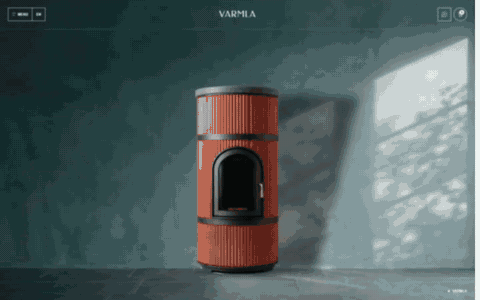

# Varmla

Varmla adalah website e-commerce untuk brand fiktif asal Stockholm yang membuat **perapian keramik bioetanol tanpa cerobong** untuk apartemen dan rumah kecil. Produknya: hearth (Round dan Oval), burner, bahan bakar nabati beraroma, dan aksesori. Pengunjung yang dituju adalah penghuni kota yang ingin api sungguhan tanpa renovasi.

Project ini adalah karya orisinal. Produk, palet warna, copy, logo, gambar, dan kode semuanya dibuat baru.

## Halaman (27)

| File | Isi |
|---|---|
| `index.html` | Home: hero turntable, manfaat, adegan senja, accordion, perbandingan, sertifikat, testimoni, CTA |
| `hearths.html` | Round dan Oval: harga, spesifikasi, galeri, 3D viewer, komponen, FAQ |
| `burners.html` | Burner manual dan otomatis |
| `fuels.html` | Enam bahan bakar beraroma, tiap produk punya popup detail bertab |
| `accessories.html` | Lima aksesori dengan spesifikasi |
| `guide.html` | Empat video panduan |
| `about.html` | Cerita, prinsip, visi, bengkel, formulir |
| `faq.html` | Sepuluh pertanyaan umum dan formulir |
| `payment-and-delivery.html` | Opsi pembayaran, tabel pengiriman, slide pengiriman dan retur |
| `blog.html` | Daftar artikel: 6 tampil, 6 lagi lewat Load more |
| `contact.html` | Kontak, data perusahaan, formulir, peta ilustrasi |
| `cart.html` | Keranjang penuh, atau state kosong |
| `thank-you.html` | Tujuan setelah formulir terkirim |
| `terms.html`, `privacy.html` | Contoh teks legal |

Artikel: `room-for-a-hearth.html`, `stove-or-hearth.html`, `electric-fire-vs-real-flame.html`, `history-of-the-tiled-stove.html`, `why-winter-evenings-feel-short.html`, `why-rest-is-not-the-same-as-sitting-still.html`, `guide-to-scented-fuels.html`, `cheaper-than-a-spa-weekend.html`, `three-ways-to-use-your-hearth.html`, `gas-vs-plant-ethanol.html`, `my-way-back-to-fire.html`, `where-to-place-your-hearth.html`.

## Fitur dan interaksi

- **Preloader**: jendela miring terbuka, lalu blur hilang; header turun setelahnya.
- **Hero turntable** (canvas 2D): foto produk diproyeksikan ulang ke silinder dan berputar mengikuti mouse; api dilukis dengan kode.
- **Scroll**: smooth wheel, hero yang tertutup seksi berikutnya, seksi tertahan, parallax, teks muncul per baris.
- **Adegan scroll** (canvas): kamera bergerak di atas foto, ruangan berubah senja, api menyala, kartu teks naik.
- **Accordion** berjalan otomatis 5 detik; **testimoni** dengan cursor BACK/NEXT dan ganti otomatis 12 detik.
- **CTA**: dua kata mengecil dan menepi, kartu naik dari bawah.
- **Toko**: tambah ke keranjang, drawer, jumlah, saran produk; tersimpan di `localStorage`.
- **State**: menu dan dropdown, menu mobile, cookie (terima/tolak/atur), roda hadiah (muncul sekali setelah 30 detik), popup produk, lightbox, video, 3D viewer (geser untuk memutar), FAQ, tab pembayaran, tooltip, validasi formulir, toast.
- **Transisi halaman** saat pindah antar halaman.
- **Responsif**: kartu geser horizontal mengikuti scroll dan tata letak khusus di mobile. `prefers-reduced-motion` dihormati.
- **Sound**: tidak ada musik atau efek suara; hanya video yang punya kontrol.

## Teknologi

HTML, CSS, dan JavaScript native, tanpa framework, library, atau langkah build. Font lokal: Archivo, Archivo Narrow, dan Federo (logo).

## Menjalankan

Buka `index.html` langsung di browser. Tambahkan `?nocookie` di URL untuk menyembunyikan banner cookie, misalnya saat merekam.

## Struktur

```
├── *.html              27 halaman
├── README.md
├── css/style.css       semua gaya
├── js/app.js           semua perilaku
├── assets/
│   ├── fonts/          archivo, archivo-narrow, federo (woff2)
│   ├── img/            120 foto, 4 cutout produk (webp), favicon
│   └── video/          showreel, guide-1..4, thanks (mp4)
└── docs/preview/       homepage.gif, hero.png
```

## Mengedit

- **Teks, harga, spesifikasi**: langsung di file `.html`. Header dan footer ada di setiap halaman, jadi ubah di semua file. Data keranjang ada di atribut `data-add`.
- **Warna**: variabel `--ink`, `--bg`, `--panel`, `--accent` di `:root` pada `css/style.css`. Beberapa warna di SVG inline dan `theme-color` ditulis langsung di HTML.
- **Gambar dan video**: ganti file di `assets/` dengan nama yang sama. Nama menunjukkan letak: `hero-*` latar besar, `info-*` kartu home, `feat-*` dan `cols-*` panel, `gal-*` galeri, `people-*` testimoni, `post-*` artikel, `oil-*`, `bot-*`, `burn-*`, `kit-*` produk.
- **Turntable**: bila mengganti `round-front.webp`, sesuaikan konstanta `G` di `js/app.js` (pusat, radius, pintu, gelang).
- **Adegan scroll**: urutan foto ada di atribut `data-shots`; `door` adalah posisi pintu dalam pecahan gambar.

## Placeholder yang perlu diganti

Brand dan tagline, `hello@varmla.example`, telepon, alamat Stockholm, nomor registrasi/VAT/bank, nama pendiri, nama dan isi testimoni, logo keanggotaan di footer, klaim pengujian dan angka produk, harga, QR (pola dekoratif, tidak bisa dipindai), peta, teks legal, kode hadiah, tautan media sosial, bahasa DE/SV, dan checkout. Formulir tidak mengirim data ke mana pun.

## Kredit aset

- **Gambar**: dihasilkan AI (Nano Banana via Google Flow).
- **Video**: Mixkit (Mixkit Free License).
- **Font**: Google Fonts, SIL Open Font License.

## Keterbatasan

- Turntable memakai satu foto depan, jadi putarannya sekitar ±34° (viewer ±38°), bukan 360°. 3D viewer dan AR bukan model 3D sungguhan.
- Adegan scroll dibuat dari foto, pencahayaan, dan api prosedural, bukan rekaman video.
- Detail perapian sedikit berbeda antar foto karena dihasilkan AI. Peti di `hero-14.jpg` memuat coretan kecil mirip huruf.
- Posisi dibandingkan lewat tangkapan layar berdampingan, tidak diukur per piksel di setiap elemen.
- Klaim keamanan dan panas bioetanol adalah contoh; periksa aturan setempat sebelum dipakai.
